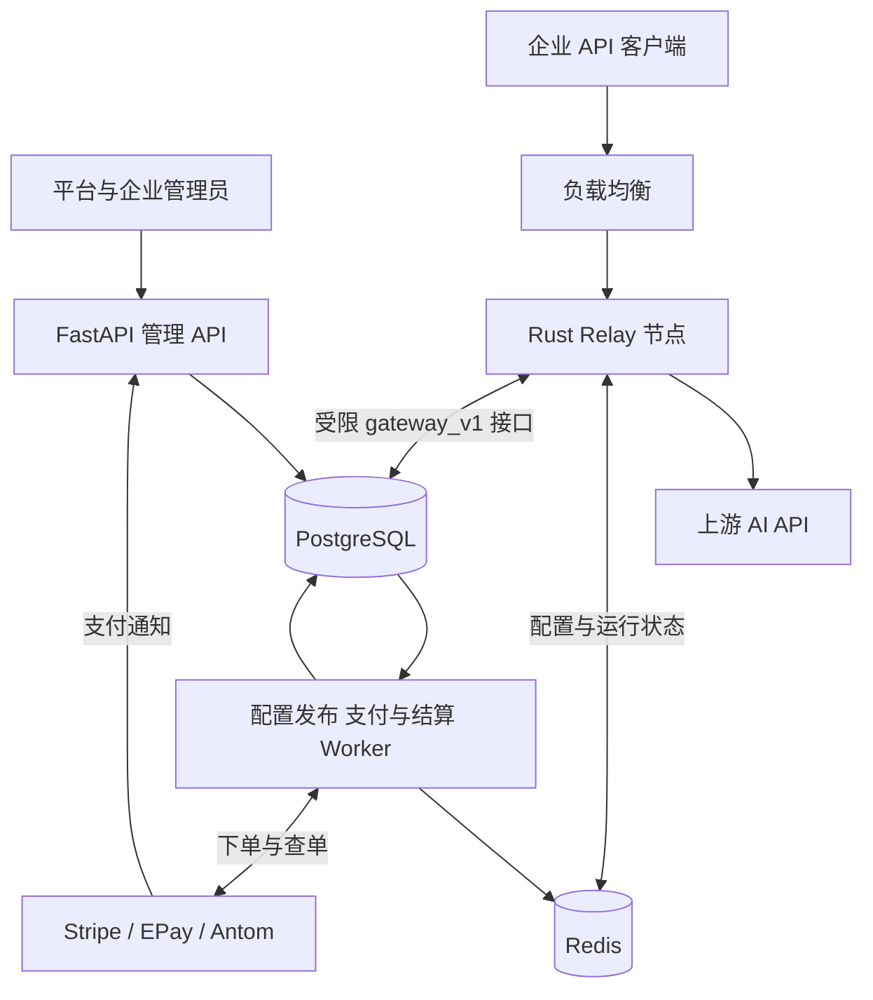

# 系统架构

API 和 Worker 独立运行，通过五个模块维护身份、目录、资金、配置和报表。PostgreSQL 保存权威事实，Redis 分发配置并协调运行状态。

## 总体结构

管理 API 不承载 AI 请求正文或流式响应。网关不执行人工入账、修改价格或直接更新账本。数据库存储过程只承担授权校验和必要的原子操作，价格归一化、结算编排、异常处理及管理流程由 Python 模块负责。

## 运行组件

| 层次 | 选择 | 说明 |
| --- | --- | --- |
| Web | FastAPI | 管理 API、支付通知入口、输入校验、OpenAPI |
| 服务运行 | Uvicorn、uvloop | uvloop 是事件循环；Uvicorn 是 ASGI 服务进程 |
| 数据库 | PostgreSQL | 业务关系、配置历史、预留、用量收件箱、账本、可靠任务 |
| 运行状态 | Redis | 配置副本、变更通知、限流、并发租约、心跳 |
| 数据访问 | SQLAlchemy 异步接口、psycopg 异步驱动 | 统一事务边界，避免同步 I/O 阻塞事件循环 |
| 迁移 | Alembic | 维护表结构、约束及 `gateway_v1` 函数 |
| 校验 | Pydantic | 各模块拥有自己的 HTTP 与消息契约，仅共享基础值类型，不暴露 ORM 模型 |
| 工程工具 | uv、Ruff、pytest | 用于依赖锁定、静态检查及领域与集成测试 |

运行时版本由仓库锁定，API 和 Worker 使用独立的连接池与进程。[运行指南](development.md)

## 模块职责

以事务和数据所有权划分五个顶层业务模块，模块内部再按用例划分子域。

| 模块 | 内部职责 | 数据所有权 |
| --- | --- | --- |
| `identity` | 用户、会话、组织、成员、项目、角色、服务账号、Key 和模型访问权限 | 身份与授权状态 |
| `catalog` | 上游、凭据、公开模型、部署、路由、RPM/TPM 和并发策略 | 可供应能力与非金额运行策略 |
| `billing` | pricing、payments、metering、wallet、budgets、settlement、reconciliation | 定价、支付、用量、金额预算和全部资金事实 |
| `publication` | 集群登记、配置编译、快照、发布任务、节点应用确认 | 已发布配置与网关管理状态 |
| `reporting` | 汇总投影、跨模块审计查询、异步导出 | 可重建的报表与导出任务，不拥有余额 |

支付订单、充值、钱包和流水放在 billing 内，自动入账才能由一个模块的事务完成。售价、折扣、计量、金额预算与预留也属于 billing，避免为一笔扣费创建跨模块写事务。`pricing`、`payments` 和 `metering` 是内部子域，不是独立部署的服务或独立数据库所有者。

每个模块拥有自己的审计、outbox 与必要的 inbox 记录，随本模块业务事务提交。reporting 通过只读门面或集成事件汇总审计；通用审计格式可以共享，跨模块的审计查询不能获得修改其他模块账表的能力。

## Python 工程组织

`src/nexus/modules/` 下的五个包各自拥有业务规则、数据表和事务。模块根的 `__init__.py` 声明公开接口，并把本模块的仓储和外部适配器装配给应用服务。进程级的 `bootstrap.py` 连接这些公开能力。

| 模块内位置 | 职责 |
| --- | --- |
| `api/` | FastAPI 路由，解析请求、提取会话、调用用例并生成 HTTP 响应。身份模块按会话与成员、项目凭据、模型策略分别组织路由。 |
| `application/` | 可从 API 或 Worker 调用的用例、命令和返回类型，以及用例所需的依赖接口。用例决定授权、状态变更和事务范围。 |
| `persistence/` | 所属模块的 ORM 映射、SQL、仓储、事务和快照读取。在资金或配置事务中，更新和审计使用同一个数据库会话。 |
| `domain/` | 独立于存储和传输的规则与值，例如 billing 的金额运算、identity 的令牌规则和模块事件。 |
| `billing/providers/` | Stripe、EPay、Antom 和测试网关的协议实现，通过支付网关接口接入。 |

修改一笔充值的入账条件时，从 `billing/application/payments/processor.py` 进入；修改 EPay 签名或查单协议时，改 `billing/providers/epay.py`；修改支付收据的数据库读写时，改 `billing/persistence/payments.py`。三个入口共享 billing 的资金约束和事务。catalog 的路由用例在 `application/routing.py`，版本检查、路由写入和审计在 `persistence/routing.py`。

进程级 `api.py` 挂载模块公开的路由，`worker.py` 调度消费任务。模块间使用根包 `__all__` 中的业务能力和数据类型。架构测试按实际包路径检查依赖方向，覆盖嵌套包和应用层内嵌 SQL。只在有对应实现时建立 `domain/` 或厂商适配包。

## 模块交互与事务

消费者定义其需要的 Protocol，例如 billing 的组织状态读取、publication 的模型快照读取。依赖组装时连接生产方的公开 API，必要时适配成消费者的只读结果，不把 ORM 对象或完整仓储传给消费者。模块间只能使用明确导出的公开能力和数据类型，不直接导入对方的 service、repository、models、schemas 等实现文件。

业务表有唯一写入模块。普通同步协作通过门面；需要跨模块改变状态时，各模块提交自己的事务，再通过带幂等键的事件或可恢复流程协作。禁止在一个 Python Session 中写两个业务模块，也禁止跨模块 JOIN 或直接查询别人的表。跨模块报表读取门面或自己的投影。

例如组织创建先由 identity 记录 provisioning 状态与 `identity.organization_created` 事件；billing 幂等建立账户并发布账户已准备事件；identity 再将组织置为 active。失败可以重放，账户未准备好时不接受收费调用，不要求两个模块共用创建事务。

模块业务修改与其 outbox、审计在同一事务中提交。消费方将 inbox 去重标记与自己的副作用一起提交，事件重复投递不会重复开账户或增加资金。事件主题使用生产方常量，载荷带 schema 版本、事件 ID、聚合 ID/版本与组织标识；不传播密钥或 ORM 实体。

PostgreSQL `gateway_v1` 是数据平面接入的特殊组合边界：允许在一次短事务中调用 identity、catalog、publication 的公开只读 SQL 契约并保持必要的授权锁，最终只写一个所属模块。例如 reserve_request 只写 billing，ack_config 只写 publication。这是为直连 PostgreSQL 的实时授权保留的明确规则，不开放任意跨模块查询或写事务，详见[通信协议](plane-protocol.md)。

共享数据库中的跨模块外键可以维护引用完整性，迁移由组装层排序，但不授权读取或更新对方的表。模块化边界不意味着将来拆分数据库无需迁移。

## 配置发布与可靠任务

管理变更在所属模块的事务内保存。配置发布将快照、凭据密文包和分发任务一起提交；Worker 更新 Redis 副本，节点确认实际应用的修订号。开启 auto_publish 的集群由 Worker 在源修订变化并静默一段时间后自动发布，使用与手动发布相同的校验。客户调用 Key 的撤销和企业冻结在数据库授权时即时校验。[网关通信协议](plane-protocol.md)

支付订单任务先持久化创建意图，Worker 在数据库事务外调用厂商。用量事件及其结算任务在一次数据库事务中写入；Worker 认领任务，事务内确认成本、扣费并更改处理状态。持久数据的查询入口见[数据模型](data-model.md)。

## 隔离和凭据

- 每个租户资源显式带 `organization_id`，授权后再查询资源；复合外键防止关联其他组织的项目或 Key。
- 人员登录会话、企业调用 Key、网关数据库身份是三类独立凭据，不能互换。
- 支付通知使用渠道规定的验签或等效认证，不继承人员会话；支付系统执行身份只能对已核实订单调用受限入账流程。
- 企业调用 Key 使用高熵随机值，只保存验证摘要和可展示标识；明文仅创建时返回。
- 上游凭据加密保存。根解密材料来自部署密钥设施，不与密文同库存放。
- 公共配置快照只包含上游凭据引用；网关通过按集群授权的加密凭据包获取必要密钥，不得到控制平面根密钥。
- 日志和审计默认只记录元数据，不记录 Authorization、调用 Key、上游密钥、提示词或响应正文。
- 网关数据库角色只具有 `gateway_v1` 规定函数的执行权限，不具有业务表读写权限；具体规则见[通信协议](plane-protocol.md)。

## 资金控制和扩容取舍

首期选择逐请求数据库预留资金与金额预算。网关获得成功的预留确认后才允许请求上游。该机制使同一企业在不同网关上的请求共享一个权威资金上限，但会增加数据库往返并竞争账户行锁。

API、Worker 与各节点的连接预算需合计。评估同一钱包上的竞争时，分别测量授权提交、用量写入和结算追赶；配置快照分发还受节点数与快照大小影响。[压测方法和实测范围](control-plane-acceptance.md)

## 故障行为

| 故障 | 设计行为 |
| --- | --- |
| 管理 API 停止 | 已启动网关可继续使用有效配置；前提是数据库授权、用量写入和限流依赖仍可用 |
| 支付网关或通知入口不可用 | 新充值可能延迟，已有余额不因此失效；恢复后通过通知重试和主动查单补齐 |
| Worker 停止 | 已提交事件保留，预留继续占用；停止结算不会让资金重新可用；积压达到阈值停止新请求 |
| PostgreSQL 不可用 | 无法确认新预留时拒绝新请求；已在途请求进入有界故障处理，不承诺仍能完整计费 |
| Redis 不可用 | 首期对依赖全局限流的新请求采用拒绝策略；不自动退化成每节点独立限额 |
| Redis 数据被重建 | 重新发布配置；限流窗口、并发租约保守恢复，资金状态仍来自 PostgreSQL |
| 配置通知丢失 | 节点通过定期检查版本补齐；启动时必须加载完整有效配置 |
| 网关突然退出 | 未完成请求和资金预留进入核对流程，不能仅因心跳或预留期限到期就释放资金 |
| 上游已经接收但连接中断 | 记录结果未知，保留请求及尝试；不得假定上游未执行并盲目重试 |

严格无状态节点在“收到上游用量、尚未提交数据库”之间崩溃，仍可能丢失最后的用量。预留和开始尝试记录提供核对线索，不能还原缺失的精确 Token 数。未知用量进入人工或上游账单核对，不估算后自动扣款。

部署配置、就绪检查和上线准备见[运行指南](development.md)。
