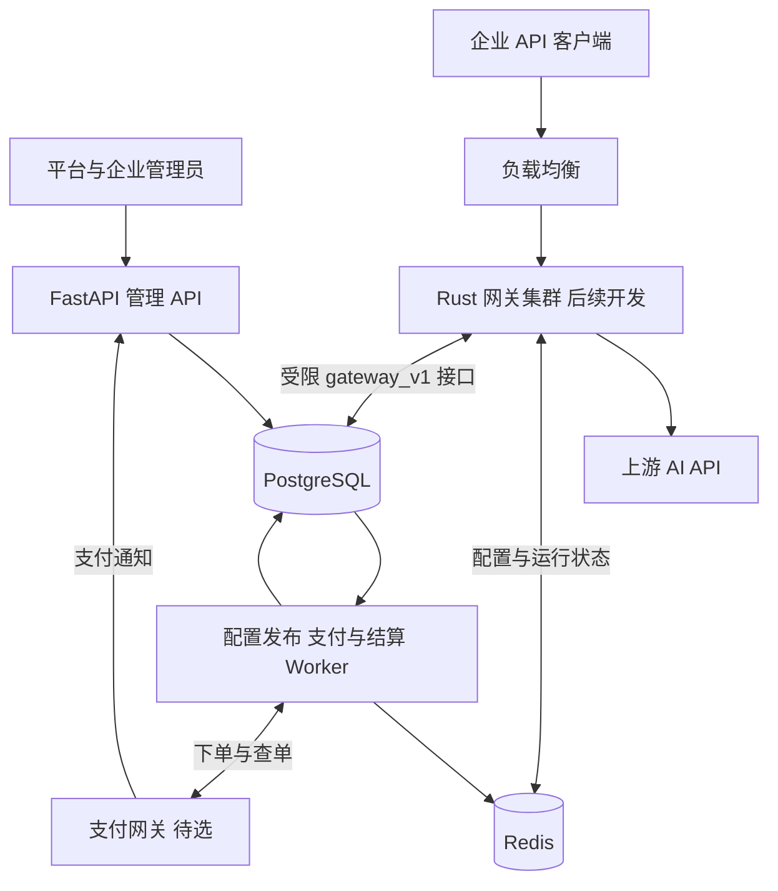

# 系统架构

控制平面采用模块化单体，API 和 Worker 共享领域代码、分别部署。PostgreSQL 保存权威业务状态；Redis 保存可重建的配置副本和有明确恢复策略的运行状态。数据平面通过受限、版本化的数据库接口协作，不读取控制平面的任意业务表。

参考 PPanel 的模块化单体思想：公开业务接口、明确依赖、单一数据属主和单域事务。目录和抽象层次按 Python/FastAPI 的实际用例组织，不把 PPanel 的框架目录作为模板。来源与采用范围见 [PPanel 设计参考](ppanel-reference.md)。Nexus 保持 Python 技术栈，支付网关仍先定义通用接口。

## 总体结构

管理 API 不承载 AI 请求正文或流式响应。网关不执行人工入账、修改价格或直接更新账本。数据库存储过程只承担授权校验和必要的原子操作，价格归一化、结算编排、异常处理及管理流程由 Python 模块负责。

## 技术选择

| 层次 | 选择 | 说明 |
| --- | --- | --- |
| Web | FastAPI | 管理 API、支付通知入口、输入校验、OpenAPI |
| 服务运行 | Uvicorn、uvloop | uvloop 是事件循环；Uvicorn 是 ASGI 服务进程 |
| 数据库 | PostgreSQL | 业务关系、配置历史、预留、用量收件箱、账本、可靠任务 |
| 运行状态 | Redis | 配置副本、变更通知、限流、并发租约、心跳 |
| 数据访问 | SQLAlchemy 异步接口、psycopg 异步驱动 | 统一事务边界，避免同步 I/O 阻塞事件循环 |
| 迁移 | Alembic | 维护表结构、约束及 `gateway_v1` 函数 |
| 校验 | Pydantic | 各模块拥有自己的 HTTP 与消息契约，仅共享基础值类型，不暴露 ORM 模型 |
| 工程工具 | uv、Ruff、pytest | 用于依赖锁定、静态检查及领域与集成测试 |

具体运行时和依赖补丁版本在项目初始化时核实兼容性后锁定，不使用浮动的生产依赖。每个并发任务使用独立的数据库 Session，不跨任务共享事务状态。[SQLAlchemy 异步并发说明](https://docs.sqlalchemy.org/en/20/orm/extensions/asyncio.html#using-asyncsession-with-concurrent-tasks)

API 可通过多个进程或多个副本扩容。容器部署基线为一个服务进程一个容器，由部署系统管理副本，Worker 单独扩容。[FastAPI 部署说明](https://fastapi.tiangolo.com/deployment/server-workers/)

运行时显式选择 uvloop，避免环境缺少依赖时无意切换事件循环；生产基线为 Linux，开发可使用 macOS。[Uvicorn 事件循环配置](https://uvicorn.dev/settings/)

## 模块职责

以事务和数据所有权划分五个顶层业务模块，模块内部再按用例划分子域。

| 模块 | 内部职责 | 数据所有权 |
| --- | --- | --- |
| `identity` | 用户、会话、组织、成员、项目、角色、服务账号、Key 和模型访问权限 | 身份与授权状态 |
| `catalog` | 上游、凭据、公开模型、部署、路由、RPM/TPM 和并发策略 | 可供应能力与非金额运行策略 |
| `billing` | pricing、payments、metering、wallet、budgets、settlement、reconciliation | 定价、支付、用量、金额预算和全部资金事实 |
| `publication` | 集群登记、配置编译、快照、发布任务、节点应用确认 | 已发布配置与网关管理状态 |
| `reporting` | 汇总投影、跨模块审计查询、异步导出 | 可重建的报表与导出任务，不拥有余额 |

支付订单、充值、钱包和流水放在 billing 内，自动入账才能由一个模块的事务完成。售价、折扣、计量、金额预算与预留也属于 billing，避免为一笔扣费创建跨模块写事务。`pricing`、`payments` 和 `metering` 是内部子域，不是独立部署的服务或独立数据库所有者。

每个模块拥有自己的审计、outbox 与必要的 inbox 记录，随本模块业务事务提交。reporting 通过只读门面或集成事件汇总审计；通用审计格式可以共享，跨模块的审计查询不能获得修改其他模块账表的能力。

## Python 工程组织

`src/nexus/modules/` 下的五个包各自拥有业务规则、数据表和事务。模块根的 `__init__.py` 声明公开接口，并把本模块的仓储和外部适配器装配给应用服务。进程级的 `bootstrap.py` 连接这些公开能力。

| 模块内位置 | 职责 |
| --- | --- |
| `api/` | FastAPI 路由，解析请求、提取会话、调用用例并生成 HTTP 响应。身份模块按会话与成员、项目凭据、模型策略分别组织路由。 |
| `application/` | 可从 API 或 Worker 调用的用例、命令和返回类型，以及用例所需的依赖接口。用例决定授权、状态变更和事务范围。 |
| `persistence/` | 所属模块的 ORM 映射、SQL、仓储、事务和快照读取。在资金或配置事务中，更新和审计使用同一个数据库会话。 |
| `domain/` | 独立于存储和传输的规则与值，例如 billing 的金额运算、identity 的令牌规则和模块事件。 |
| `billing/providers/` | Stripe、EPay、Antom 和测试网关的协议实现，通过支付网关接口接入。 |

修改一笔充值的入账条件时，从 `billing/application/payments/processor.py` 进入；修改 EPay 签名或查单协议时，改 `billing/providers/epay.py`；修改支付收据的数据库读写时，改 `billing/persistence/payments.py`。三个入口共享 billing 的资金约束和事务。catalog 的路由用例在 `application/routing.py`，版本检查、路由写入和审计在 `persistence/routing.py`。

进程级 `api.py` 挂载模块公开的路由，`worker.py` 调度消费任务。模块间使用根包 `__all__` 中的业务能力和数据类型。架构测试按实际包路径检查依赖方向，覆盖嵌套包和应用层内嵌 SQL。只在有对应实现时建立 `domain/` 或厂商适配包。

## 模块交互与事务

消费者定义其需要的 Protocol，例如 billing 的组织状态读取、publication 的模型快照读取。依赖组装时连接生产方的公开 API，必要时适配成消费者的只读结果，不把 ORM 对象或完整仓储传给消费者。模块间只能使用明确导出的公开能力和数据类型，不直接导入对方的 service、repository、models、schemas 等实现文件。

业务表有唯一写入模块。普通同步协作通过门面；需要跨模块改变状态时，各模块提交自己的事务，再通过带幂等键的事件或可恢复流程协作。禁止在一个 Python Session 中写两个业务模块，也禁止跨模块 JOIN 或直接查询别人的表。跨模块报表读取门面或自己的投影。

例如组织创建先由 identity 记录 provisioning 状态与 `identity.organization_created` 事件；billing 幂等建立账户并发布账户已准备事件；identity 再将组织置为 active。失败可以重放，账户未准备好时不接受收费调用，不要求两个模块共用创建事务。

模块业务修改与其 outbox、审计在同一事务中提交。消费方将 inbox 去重标记与自己的副作用一起提交，事件重复投递不会重复开账户或增加资金。事件主题使用生产方常量，载荷带 schema 版本、事件 ID、聚合 ID/版本与组织标识；不传播密钥或 ORM 实体。

PostgreSQL `gateway_v1` 是数据平面接入的特殊组合边界：允许在一次短事务中调用 identity、catalog、publication 的公开只读 SQL 契约并保持必要的授权锁，最终只写一个所属模块。例如 reserve_request 只写 billing，ack_config 只写 publication。这是为直连 PostgreSQL 的实时授权保留的明确规则，不开放任意跨模块查询或写事务，详见[通信协议](plane-protocol.md)。

共享数据库中的跨模块外键可以维护引用完整性，迁移由组装层排序，但不授权读取或更新对方的表。模块化边界不意味着将来拆分数据库无需迁移。

## 配置与边界验证

启动配置包含连接、监听地址和根密钥来源，进程运行期间保持不变。运行时业务配置由各属主模块管理，按版本产生不可变快照；每次用例读取一致的配置版本，不在多个请求间修改共享可变字典。

模块边界由两类检查验证。AST 检查跨模块导入和分层依赖，真实 PostgreSQL 集成测试验证五个数据库角色、事务作用域及网关函数权限。

导入规则和组装检查已纳入 CI 配置。新增模块、跨模块依赖或 SQL 契约需更新所有权声明与针对性测试。

## PostgreSQL 与 Redis 的职责

PostgreSQL 是账户、价格、配置版本、资金预留、计量事件和账本的权威来源。Redis 不保存唯一的收费证据，也不保存一个可以独立覆盖数据库余额的“真实余额”。

配置发布采用事务性 outbox：保存配置版本和发布任务在同一事务中完成；Worker 重试同步到 Redis。Redis 发布完成但数据库确认失败时允许重复发布，通过单调版本号和内容摘要消除副作用。

Redis Pub/Sub 只用于提示配置变化；节点始终能通过完整快照和版本检查恢复。Pub/Sub 无法重放离线期间的消息。[Redis Pub/Sub 语义](https://redis.io/docs/latest/develop/use-cases/pub-sub/)

首期用量直接提交到 PostgreSQL 收件箱，接收成功与业务结算成功分别表示。未来引入 Redis Streams 时仍必须保留幂等、持久化确认和对账路径，不能把消费确认等同于不会丢失数据。[Redis Streams](https://redis.io/docs/latest/develop/data-types/streams/)、[Redis 复制保证](https://redis.io/docs/latest/operate/oss_and_stack/management/replication/)

正常用量由持续运行的 Worker 自动处理，初始空闲轮询间隔为 500 ms；有待处理任务时连续消费，不等待日终批处理。接近实时扣费的目标、测量起点和异常边界见[计量与账务](billing.md)。

支付订单、通知收件箱和收款事实也保存在 PostgreSQL。Payment Worker 调用 billing 门面，由模块内部支付服务通过适配器查单，再进入共同的账务过账流程；Redis 不保存唯一支付状态。支付凭据与通知密钥留在控制平面，数据平面不参与收款。接口与事务边界见[支付网关与自动入账](payments.md)。

## 可靠任务

outbox、支付下单与查单、用量处理和导出任务保存在 PostgreSQL。Worker 以短事务认领任务，记录 `lease_owner`、`lease_until`、`attempts`、`next_attempt_at`。领取可使用 `FOR UPDATE SKIP LOCKED`；租约超时后允许其他 Worker 接管。

网络 I/O 不放在长数据库事务中。任务副作用使用稳定的业务幂等键，完成时检查租约或代次。超过重试策略后进入待处理队列并告警，不删除原始任务或直接标记成功。账务写入与对应任务状态更新在同一事务中完成。

FastAPI 进程内后台任务仅用于可丢弃的辅助工作，不承担配置发布、支付入账、账务结算或重要审计。支付任务与 Token 结算任务分别设置并发和资源配额，网关查单缓慢不能占满消费结算 Worker。

## 隔离和凭据

- 每个租户资源显式带 `organization_id`，授权后再查询资源；复合外键防止关联其他组织的项目或 Key。
- 人员登录会话、企业调用 Key、网关数据库身份是三类独立凭据，不能互换。
- 支付通知使用渠道规定的验签或等效认证，不继承人员会话；支付系统执行身份只能对已核实订单调用受限入账流程。
- 企业调用 Key 使用高熵随机值，只保存验证摘要和可展示标识；明文仅创建时返回。
- 上游凭据加密保存。根解密材料来自部署密钥设施，不与密文同库存放。
- 公共配置快照只包含上游凭据引用；网关通过按集群授权的加密凭据包获取必要密钥，不得到控制平面根密钥。
- 日志和审计默认只记录元数据，不记录 Authorization、调用 Key、上游密钥、提示词或响应正文。
- 网关数据库角色只具有 `gateway_v1` 规定函数的执行权限，不具有业务表读写权限；具体规则见[通信协议](plane-protocol.md)。

## 资金控制和扩容取舍

首期选择逐请求数据库预留资金与金额预算。网关获得成功的预留确认后才允许请求上游。该机制使同一企业在不同网关上的请求共享一个权威资金上限，但会增加数据库往返并竞争账户行锁。

此选择优先验证计费正确性，不预先声称能承载某个请求率。同一大客户的账户锁、用量写入速度、连接数和结算积压都需要测量。后续可以考虑按集群或节点发放有上限、可追溯的额度租约，不能直接删除资金协调过程。

每个节点使用有界连接池。API、Worker、网关连接池上限之和需纳入数据库容量预算，扩容网关不能默认等比例增加无限数据库连接。数据库角色和协议函数允许将来在前面加一个接入服务，而不改变事件含义。

## 故障行为

| 故障 | 设计行为 |
| --- | --- |
| 管理 API 停止 | 已启动网关可继续使用有效配置；前提是数据库授权、用量写入和限流依赖仍可用 |
| 支付网关或通知入口不可用 | 新充值可能延迟，已有余额不因此失效；恢复后通过通知重试和主动查单补齐 |
| Worker 停止 | 已提交事件保留，预留继续占用；停止结算不会让资金重新可用；积压达到阈值停止新请求 |
| PostgreSQL 不可用 | 无法确认新预留时拒绝新请求；已在途请求进入有界故障处理，不承诺仍能完整计费 |
| Redis 不可用 | 首期对依赖全局限流的新请求采用拒绝策略；不自动退化成每节点独立限额 |
| Redis 数据被重建 | 重新发布配置；限流窗口、并发租约保守恢复，资金状态仍来自 PostgreSQL |
| 配置通知丢失 | 节点通过定期检查版本补齐；启动时必须加载完整有效配置 |
| 网关突然退出 | 未完成请求和资金预留进入核对流程，不能仅因心跳或预留期限到期就释放资金 |
| 上游已经接收但连接中断 | 记录结果未知，保留请求及尝试；不得假定上游未执行并盲目重试 |

严格无状态节点在“收到上游用量、尚未提交数据库”之间崩溃，仍可能丢失最后的用量。预留和开始尝试记录提供核对线索，不能还原缺失的精确 Token 数。未知用量进入人工或上游账单核对，不估算后自动扣款。

## 部署与运维基线

本机开发使用 API、Worker 和原生 PostgreSQL/Redis 专用实例，启动与清理脚本见[开发说明](development.md)，不配置 Docker。生产环境分别部署并使用私网、TLS 和最小权限访问，生产部署资源在后续阶段安排。

数据库启用持久化提交、备份与恢复演练。复制模式、RPO、RTO 在生产部署前确定；默认异步复制不能被描述为故障切换零丢失。Redis 的限流和并发状态应使用不随意逐出的配置，与大量可淘汰缓存分开规划容量。

观测指标至少包含 API 延迟与错误、数据库池等待、锁等待、发布滞后、节点配置滞后、用量积压、结算延迟、支付确认与入账延迟、超期预留、重复或冲突事件、对账差额。心跳用于运维观察，负载均衡以节点 readiness 判断能否接入新请求。

后续网关升级时先停止接收新请求，等待在途流式请求和用量提交完成。单次流式响应不会迁移到另一个节点；独立请求不要求会话粘滞。
