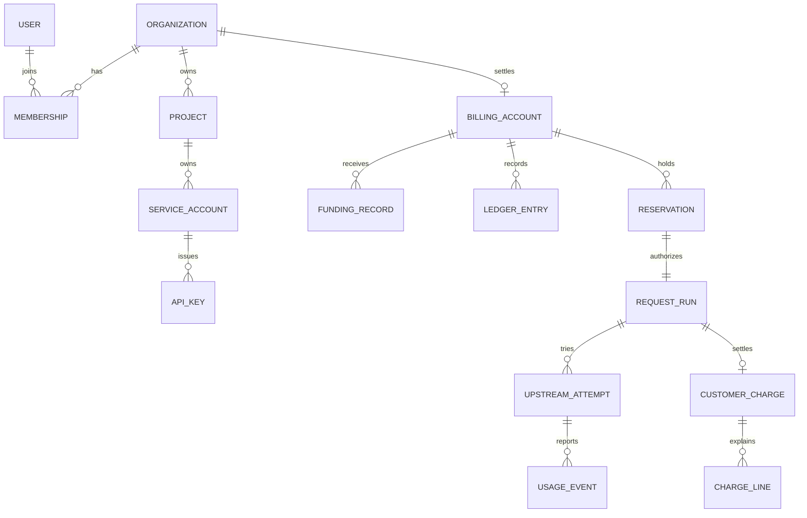

# 数据模型

本文件定义首期逻辑模型和数据库必须维护的约束。具体迁移随实施阶段落地；逻辑实体可以在不削弱约束的前提下合并为物理表，不需要一次性创建所有表。

M1 已迁移模块 schema 及管理员引导存储。M2 已实现身份与项目凭据存储，并增加 catalog 的模型、上游、加密凭据、部署与审计，以及 identity 的访问策略和模型关联表。计费和配置发布等其余表仍为后续阶段的逻辑设计。

## 模块与数据所有权

参考 PPanel 的单域事务规则，每张业务表有唯一属主。下文表名为逻辑名称，物理表按 identity、catalog、billing、publication、reporting schema 归属；模块不能借共享数据库直接访问其他模块的仓储。

| 属主 | 业务数据 |
| --- | --- |
| identity | 用户、会话、平台角色、组织、成员、项目、项目授权、服务账号、Key、模型访问策略 |
| catalog | 上游、上游凭据、模型、部署、路由、RPM/TPM/并发策略 |
| billing | 成本、售价、客户折扣、账户、入账、流水、调整、支付渠道与订单、支付证据、金额预算、预留、请求尝试、用量、费用、核对事项 |
| publication | 网关集群与身份登记、配置快照和发布、按集群封装的凭据包、节点应用确认 |
| reporting | 报表与审计投影、导出任务和结果引用 |

每个模块自己的 `audit_events`、`idempotency_records`、`outbox`、`inbox` 随该模块事务维护；下文同名描述代表统一的技术结构，不代表任意模块可写的全局业务仓储。`config_outbox` 是 publication 的专用发布任务，`payment_events` 是 billing 的支付通知收件箱。

跨模块读通过公开门面或只读快照，跨模块写通过各属主事务和可重放事件完成。金融事实全部归 billing，支付入账、预留和消费结算不跨写入所有权边界。两平面 SQL 接口遵守[通信协议](plane-protocol.md)定义的只读组合例外。

## 通用约定

- 使用 UUID 作为业务主键，不通过递增 ID 推断租户或权限。配置修订号单独使用单调递增整数。
- 时间使用 `timestamptz`，传输为带 `Z` 的 UTC 时间。区分发生时间、接收时间、授权时间和记账时间。
- 金额与价格规则见[计量与账务](billing.md)。金额传输为字符串，Token 数为非负整数。
- 租户实体带 `organization_id`，并通过 `(organization_id, resource_id)` 复合键约束其下级关联。
- 核心关系使用列、外键和唯一约束；JSONB 用于配置内容、版本化消息和用量证据，不承载可绕过外键的账务关联。
- 可编辑资源带 `version`，用于乐观并发控制；账本和已发布版本采用追加写入。
- 停用或归档不删除历史引用。删除组织、Key 或模型不能级联删除消费流水。

## 实体关系

请求关闭事件直接属于请求，不要求绑定某个尝试；图中的尝试到用量事件关系表示尝试级事件。

## 身份与权限

| 实体 | 主要字段 | 约束 |
| --- | --- | --- |
| `users` | id、login、password_hash、status | 登录标识唯一，密码不以明文保存 |
| `platform_role_bindings` | user_id、role | 平台角色独立于企业成员角色 |
| `admin_sessions` | token_digest、user_id、expires_at、revoked_at | 令牌摘要唯一，可撤销，不能当企业调用 Key 使用 |
| `password_setup_tokens` | token_digest、user_id、expires_at、revoked_at | 一次性使用；重发撤销原凭据；成功兑换撤销旧会话 |
| `organizations` | id、name、status、version | provisioning、active、suspended、archived 状态明确；账户准备好后才能收费调用 |
| `memberships` | organization_id、user_id、role、status | 同一用户与组织的成员关系唯一 |
| `projects` | id、organization_id、name、status | 组织内名称或业务标识唯一 |
| `project_grants` | organization_id、membership_id、project_id | 成员与项目必须属于同组织 |
| `service_accounts` | id、organization_id、project_id、name、status | 项目和组织一致 |
| `api_keys` | id、organization_id、project_id、service_account_id、digest、prefix、expires_at、revoked_at | 摘要唯一，关联身份在同一租户内 |

用户可处于 pending、active 或 disabled；pending 用户通过一次性凭据设置密码后激活。组织内部保留 resume_status 支持暂停后恢复原状态，成员和组织使用 version 做条件更新。以上字段不会赋予客户端设置平台角色或绕过账户准备的能力。

API Key 不保存明文。创建请求的幂等记录不能为了重放响应而持久化明文 Key；如果首次响应丢失，客户端查看资源标识后显式轮换，见[管理 API](management-api.md)。

API Key 记录 version、prefix、expires_at、revoked_at、rotated_at 和 rotated_from_id；轮换关系受同组织、项目和服务账号的复合外键与唯一约束保护。项目授权记录 active/revoked 状态，项目与服务账号状态也参与凭据校验。Key 操作幂等记录当前保存 actor_id、operation、key_digest、request_digest 和 resource_id，只引用结果资源，不保存响应明文，也不自动过期。

“至少一个有效 owner”等跨行规则由受控事务与组织锁维护。项目授权、成员停用和 Key 撤销均记录审计。

## 上游、模型和策略

| 实体 | 主要字段 | 约束 |
| --- | --- | --- |
| `upstreams` | id、name、base_url、protocol_family、status | 地址和协议族经发布校验，不包含内嵌凭据 |
| `upstream_credentials` | id、upstream_id、ciphertext、key_version、status | 凭据不可从普通查询接口读回 |
| `models` | id、public_name、capabilities、usage_schema、limits、status | public_name 唯一，声明支持的计量维度与上界 |
| `deployments` | id、model_id、upstream_id、credential_id、upstream_model、region、status | 一个公开模型可映射多个上游部署 |
| `access_policies` | organization_id、layer、scope_type、scope_id、allowed_models、version | layer 区分平台约束与客户约束；作用域属于该组织 |
| `route_policies` | scope、model_id、candidates、priority、weight、version | 候选引用有效部署，首期无成本或延迟自动优化 |
| `quota_policies` | organization_id、layer、scope、metric、limit、period、version | catalog 拥有，只含 RPM、TPM 和并发；平台和客户限制共同生效 |

访问策略实际使用 access_policies 与 access_policy_models 分表存储，后者以外键关联 catalog.models，只维护引用，不授予 identity 对目录私有表的读取权限。项目与 Key 作用域使用复合外键约束租户关系。上游凭据使用带记录绑定信息的 AEAD 密文，key_version 指向部署配置中的根密钥版本；明文及根密钥不进数据库。

`scope` 只允许组织、项目或 Key 等受控类型。实现时可使用独立关联表或显式可空外键加互斥约束，不使用无法验证归属的任意字符串外键。

同一层的空模型白名单表示无访问权限；未配置下级覆盖表示继承上级。实际授权是所有适用限制的交集，子级不能扩大父级许可。

## 价格与账户

M3 物理实现使用 billing.accounts、receiving_accounts、funding_records、ledger_entries、adjustments、price_versions、discount_versions、budget_policies、budget_periods、budget_holds、request_runs 和 request_attempts。price_versions 以 kind 区分售价与成本；request_runs 同时保存预留状态与结算结果。用量收件箱与支付表将在后续迁移加入。

| 实体 | 主要字段 | 约束 |
| --- | --- | --- |
| `sale_price_versions` | id、version、currency、status、effective_from | 统一售价版本，发布后不可变，同作用域生效起点唯一 |
| `sale_price_items` | sale_price_version_id、model_id、dimension、unit_quantity、unit_price | 同版本模型和维度唯一 |
| `cost_price_versions` | id、deployment_id、version、currency、status、effective_from | 同一部署成本版本的生效起点唯一 |
| `cost_price_items` | cost_price_version_id、dimension、unit_quantity、unit_price | 同版本计量维度唯一 |
| `customer_discount_versions` | id、organization_id 或默认作用域、version、factor、effective_from、status | 同客户生效起点唯一；默认版本 factor=1；已发布不可变 |
| `billing_accounts` | id、organization_id、currency、balance、held_amount、status、version | 首期组织一账户；balance >= held_amount >= 0 |
| `funding_records` | account_id、source_type、payment_order_id、payment_receipt_id、amount、currency、receipt_namespace、external_reference、received_at、status、actor_type、actor_id | source_type 为 manual 或 gateway；收款来源唯一；posted 后不可编辑 |
| `ledger_entries` | id、account_id、signed_amount、kind、source_id、reverses_entry_id、posted_at | 稳定业务来源唯一，禁止覆盖和删除 |
| `adjustments` | id、account_id、source_id、reason、evidence、amount、status、actor_id | 引用原记录，过账后不可变，限制累计调整金额 |
| `budget_policies` | organization_id、layer、scope、currency、limit_amount、period、version | billing 拥有金额预算策略，不与 catalog 的速率策略共表 |

金额预算的实现实体为 `budget_periods` 和 `budget_holds`。前者保存策略版本、作用域、UTC 期间、上限、已消费与预留；后者保存请求对某期间的占用。唯一键至少覆盖 `(policy_id, period_start)` 和 `(request_id, budget_period_id)`。物理 budget_holds 另携带 organization_id，通过复合外键保证请求、预算期间与策略属于同一组织；request_runs 的企业、项目、服务账号与 Key 归属也由复合外键约束。

价格与折扣的 `effective_until` 在查询时由下一已发布版本派生，使用左闭右开的生效区间；发布后不改原价格内容或生效起点。默认折扣作用域与特定组织作用域分开约束，授权函数校验所用折扣确实适用于请求组织。

已生效预算策略修改不会删除旧期间或请求占用。减少预算到 `spent + reserved` 以下时，保留已有占用并拒绝新授权；返回明确的超限状态，不能将预留清零。

## 支付与收款

支付凭据和第三方字段通过控制平面适配器使用，不进入两平面通信协议。

| 实体 | 主要字段 | 约束 |
| --- | --- | --- |
| `payment_channels` | id、adapter_type、stable_merchant_id、environment、active_config_version_id、status | 商户身份与 test/live 环境创建后不变；停用不删除历史订单配置 |
| `payment_channel_versions` | id、channel_id、version、encrypted_credentials、verification_keys、capabilities、allowed_currency、created_at | 不可变配置版本；订单绑定版本，轮换保留在途查询与验签材料 |
| `payment_orders` | id、organization_id、account_id、channel_id、channel_config_version、merchant_order_ref、provider_payment_ref、amount、credit_amount、currency、checkout_result、state_version、checkout_generation、checkout_state、payment_state、credit_state、review_required、expires_at | 商户订单号唯一；期望金额不变；支付入口可复用，绑定交易采用条件更新 |
| `payment_events` | id、channel_id、receipt_namespace、provider_event_id、event_fingerprint、verified_fields、body_digest、received_at、processing_state | 验签后保存最小事件；稳定事件 ID 或摘要去重；财务安全另有业务唯一约束 |
| `payment_observations` | id、order_id、source、state、provider_transaction_id、amount、reversed_amount、disputed_amount、currency、merchant_identity、observed_at、evidence_digest | 追加保存服务端查单与核对证据，不用旧通知覆盖新事实 |
| `payment_receipts` | id、order_id、receipt_namespace、provider_transaction_id、amount、currency、observation_id、confirmed_at | 同命名空间外部交易号唯一；额外真实收款需记录并核对 |
| `payment_operations` | id、order_id、kind、idempotency_key、fencing_token、remote_started_at、lease、attempts、next_attempt_at、state | 持久化创建意图；接管未知操作先查原订单，不能因租约到期重新无条件下单 |

`funding_records.payment_order_id` 对非空值唯一，保证每个支付订单最多一个原始充值；gateway 来源必须关联已核实订单和收款事实，manual 来源的 actor 必须为具名财务人员。系统自动入账使用具名服务身份，不伪造某个人的操作。

所有入账共享 `(receipt_namespace, external_reference)` 唯一约束。命名空间由服务端依据已配置的真实收款账户或网关商户与环境生成，不能由客户端任意填写。渠道配置或密钥轮换不能产生新的交易命名空间。

支付交易相关的人工补录通过原订单进行核实，沿用同一交易号。订单、充值记录、余额、资金流水和审计在一个事务中完成原始入账。支付事件去重不替代收款与账本唯一性。

手续费、净结算金额和结算时间可以作为收款附加信息记录；不能覆盖原订单金额或客户充值额度。退款、争议和未追回款项关联 `reconciliation_cases` 与调整链，不通过修改原充值记录隐藏。

## 请求、预留与计量

| 实体 | 主要字段 | 约束 |
| --- | --- | --- |
| `request_runs` | request_id、organization_id、project_id、api_key_id、node_id、model_id、config_revision、sale_price_version_id、discount_version_id、billing_policy_version、admitted_at、state | request_id 唯一；组织、售价和折扣由服务端确定 |
| `reservations` | id、request_id、account_id、amount、state、review_after、review_required | request_id 唯一；到期不会自动释放 |
| `upstream_attempts` | attempt_id、request_id、sequence、deployment_id、cost_price_version_id、started_at、state | attempt_id 唯一；(request_id, sequence) 唯一 |
| `usage_events` | event_id、schema_version、event_type、request_id、attempt_id、payload、received_at、processing_state | event_id 唯一；同 ID 不同内容为冲突 |
| `normalized_usage` | event_id、attempt_id、normalizer_version、quantities、evidence_reference | 原始证据保留，修正记录追加并显式关联 |
| `customer_charges` | id、request_id、sale_price_version_id、discount_version_id、currency、amount、state、posted_at | 每个请求唯一的初始客户结算 |
| `charge_lines` | charge_id、dimension、quantity、base_unit_price、discount_factor、unit_quantity、unrounded_amount | 支持复算；基础价格和折扣分别保留 |
| `attempt_costs` | attempt_id、cost_price_version_id、currency、amount、state | 每个尝试独立记录成本；与客户费用状态分离 |

同一事件 ID 内容相同，返回原接收结果；内容不同时拒绝并审计。额外约束每个尝试最多一个原始 `attempt.finished` 事实，每个请求最多一个原始 `request.closed` 事实，防止调用方换事件 ID 绕过去重。事实修正走受控调整流程。

一个请求可以产生多次成本记录，但最多一个初始客户费用记录；后续调整有独立来源 ID。客户已结算不意味着所有上游成本都已经核对。

基础单价使用 `NUMERIC(28,12)`，折扣使用 `NUMERIC(7,6)`；`charge_lines.unrounded_amount` 使用 `NUMERIC(44,24)`，容纳单价、折扣及每百万单位换算的小数精度。计算使用至少 60 位 Decimal 上下文并检查存储边界；最终账户金额仍按统一的 12 位规则处理，不靠数据库隐式截断完成舍入。

## 配置与基础设施状态

| 实体 | 主要字段 | 约束 |
| --- | --- | --- |
| `gateway_clusters` | id、name、region、status、credential_public_key_version | 集群授权范围独立于组织身份 |
| `gateway_principals` | id、database_role、cluster_id、node_id、status | 数据库认证身份唯一，不能信任消息自报身份 |
| `config_snapshots` | cluster_id、revision、schema_version、payload_bytes、sha256、created_at、source_revision | 同集群修订号唯一；字节内容不可变 |
| `config_releases` | cluster_id、revision、state、published_at | 区分期望发布、已分发和节点已应用 |
| `config_outbox` | task_id、cluster_id、revision、lease、attempts、next_attempt_at、state | 重试同版本不产生新版本 |
| `credential_envelopes` | cluster_id、credential_id、credential_version、encryption_key_version、ciphertext | 包含集群范围，公共快照只引用 |
| `node_config_acks` | node_id、revision、applied_at、error_code | 节点应用状态可审计，不能覆盖更高版本确认 |
| `audit_events` | actor、organization_id、action、resource、redacted_change、reason、created_at | 不包含原始密钥或请求正文 |
| `idempotency_records` | principal、scope、key、request_digest、result_reference、expires_at | 相同作用域和键唯一，业务唯一约束长期保留 |
| `export_jobs` | organization_id、filters、state、result_reference、expires_at | 下载时再次校验租户和角色 |
| `reconciliation_cases` | organization_id、source_type、source_id、reason、state、evidence、resolution_reference | 关联请求、成本或账务来源，处理结果留审计 |

Redis 运行状态及键命名见[通信协议](plane-protocol.md)，不在这里重复创建数据库主表。

## 事务与索引

所有账户变更按同一锁顺序执行：账户、业务单据（请求及预留或支付订单）、按 ID 排序的预算期间、来源记录。涉及多个账户的内部管理操作按账户 ID 排序；首期不开放账户间转账。支付入账流程不反向锁定消费请求，支付网络调用在事务外执行。

在 gateway_v1 允许的 SQL 组合事务中，先通过属主公开只读契约按固定类型和 ID 顺序取得相关主体锁，再进入上述资金锁顺序；不直接读取外域私有表，不写身份或目录状态。撤销和授权遵循同一协调顺序。普通 Python 模块不能以此为由拿到跨域 Session。

数据库必须提供以下唯一性保障，不能只由 Python 先查后写：收款命名空间与外部交易号、商户支付订单号、支付订单原始充值、请求 ID、尝试 ID、事件 ID、事件业务事实键、初始客户结算、资金流水来源和幂等作用域。

租户查询索引以 `organization_id` 开头，结合时间和稳定游标 ID。收件箱与任务按状态和 `next_attempt_at` 索引；预留按账户、状态和核对期限索引；价格按适用对象与生效区间索引。

暂不预先按时间分区全部表。引入分区前须解决跨分区事件去重和流水来源唯一性，必要时保留独立的全局去重表，不能为分区删除业务唯一约束。

## 保留与删除

原始用量证据、历史价格、支付收款证据、账本、调整、配置引用和关键审计按各自保留政策管理。消费或充值所引用的记录在引用存续期间不得删除。首期不自动清理账务历史。

运行心跳可以短期过期，费用汇总可以删除重建；原始资金流水不可用汇总表替代。导出文件应有有效期和访问控制，过期删除导出副本不删除账务来源。

业务数据归档、个人信息删除和法定保留期限在生产部署前制定具体政策，不能把统一的“软删除”当成所有数据类别的处理方式。
