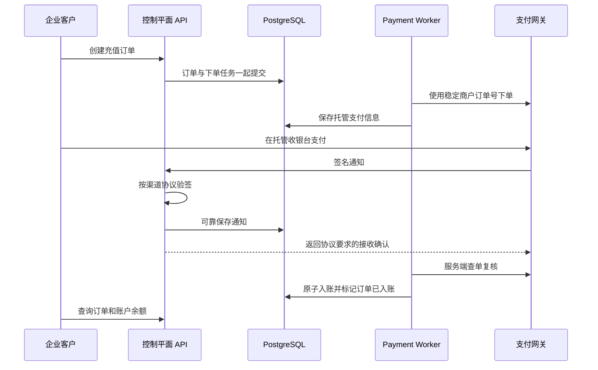

# 支付网关与自动入账

Nexus 为预付费账户提供两种资金入口：财务人工登记，以及支付网关确认成功后的自动入账。两条路径共用资金账本、币种规则、幂等约束和对账机制。

当前先定义通用支付接口和控制平面流程，具体网关稍后确定。本文不表示任何网关已经接入；真实自动入账需要选定适配器并完成其沙箱和上线验收。

职责划分参考 PPanel 的支付适配、回调、下单和共同结算逻辑，不要求相同的包目录。Nexus 中支付是 billing 的内部子域，与钱包、资金流水共用一个数据所有权边界；来源见 [PPanel 设计参考](ppanel-reference.md)。

## 范围与职责

企业 owner 或财务成员创建充值订单，服务端返回托管收银台地址或支付码。支付网关负责收款，Nexus 根据服务端验证过的支付事实增加该企业的预付费余额。

首期不实现银行卡信息采集、自动保存支付方式、余额不足时自动扣卡、订阅扣款或自动对外退款。客户端发起一次充值与自动入账是同一订单流程；自动入账不意味着可以未经客户发起而自动扣款。

| 组件 | 职责 |
| --- | --- |
| billing 内的支付子域 | 订单、渠道、状态转换、回调收件箱、查单补偿与支付对账 |
| 支付适配器 | 下单、查询、验签、事件归一化、协议响应与能力声明 |
| billing 内部 wallet 与 settlement | 入账验证、唯一资金来源、余额更新、流水与调整 |
| 管理 API | 受授权的订单创建和查询、支付渠道管理 |
| Webhook 入口 | 认证外部通知，可靠接收后快速应答 |
| Payment Worker | 调用 billing 支付处理门面；网络查单、状态核实与入账编排由模块内部完成 |

所有支付凭据只由控制平面使用，不发布到 Rust 网关或网关配置快照。支付网关故障不会直接阻止已有余额的客户继续调用 AI API。

## Registry 与协议边界

GatewayRegistry 是支付子域中唯一选择厂商实现的位置。它注册已安装的适配器工厂、配置 schema、能力声明和 NotificationStyle；数据库只保存注册类型标识与配置，不能提供任意 Python 导入路径或可执行代码。

创建或修改渠道时，Registry 先验证并规范化类型化配置；开启网关对象时绑定一个不可变配置快照。HTTP 客户端、时钟和测试替身通过构造注入，不让每个业务流程自行创建客户端或读取全局配置。

```text
模块 HTTP / task 入口
  -> billing 公开门面
    -> payments checkout / callbacks / reconciliation
      -> GatewayRegistry.open(渠道配置快照)
        -> PaymentGateway
          -> protocols 厂商 SDK 或协议客户端
    -> 共同的支付确认与 funding 过账原语
      -> BillingUnitOfWork
```

`protocols` 只处理签名、序列化、HTTP、外部状态和金额单位，不依赖 ORM、FastAPI 或钱包。Gateway 将协议结果映射为标准支付事实。订单匹配、资金约束和是否可以过账由共同的业务流程决定，不能在每个供应商中分别实现增余额逻辑。

支付子域与 wallet 可以在 billing 内通过明确的内部端口协作，最终由同一个 BillingUnitOfWork 提交订单、入账记录、钱包、流水、审计和 outbox。其他模块只能调用 billing 的公开能力，不能导入这套内部实现。

## 通用适配器契约

通用接口表达业务含义，不假设不同支付服务具有相同 URL、签名算法、回调格式或状态码。适配器不得直接修改组织余额。

| 操作 | 输入 | 输出与约束 |
| --- | --- | --- |
| `capabilities` | 渠道配置 | 支持币种与金额精度、查单能力、下单幂等方式、通知认证方式、可选关单能力 |
| `create_payment` | 不变的商户订单号、金额、币种、服务端回调地址、固定返回地址、幂等标识 | 外部支付对象引用、托管地址或支付码、状态；未知结果不能映射为明确失败 |
| `query_payment` | 商户订单号或已确认的外部支付对象引用 | 经服务端认证获得的支付状态、交易号、金额、币种、商户和环境 |
| `parse_notification` | 原始方法、路径、查询字节、多值表单、请求头、请求体、渠道验签材料 | 在同一入口完成认证和归一化，只返回 VerifiedNotice；不暴露可绕过验签的业务解析入口 |
| `check_binding` | 不可变 PaymentExpectation、VerifiedNotice 或查单事实 | 补充厂商特有的订单元数据核对；共同流程始终校验组织、订单、金额、币种与商户 |
| `build_notification_response` | 已持久化接收、有效但忽略、拒绝或暂时失败 | 符合该渠道协议的 HTTP 状态、正文和 Content-Type |
| `close_payment` | 商户订单引用 | 可选能力；不支持时不模拟已关单 |

核心契约为 PaymentExpectation、CheckoutResult、NotificationEnvelope、VerifiedNotice、PaymentObservation 和 NotificationDisposition。它们是 billing 自有的不可变值对象，不接收整个 ORM Order 或 FastAPI Request。PaymentExpectation 固定订单、账户、渠道商户、环境、金额和币种；CheckoutResult 首期只允许受控的 redirect 或 qr_code 类型，并声明有效期。

NotificationStyle 声明允许的 HTTP 方法、原始 body 或表单模式、是否要求参数唯一、报文上限以及应答风格。表单或 query 需保留多值信息直到检查完成，不能先转换成单值字典再丢掉重复签名字段。handler 按样式收集原始请求，再调用 billing 门面，不直接选择 SDK。

内部错误区分 `invalid_notification`、`pending`、`unconfirmed`、`retryable_failure` 和 `manual_review`。未确认表示缺少足够证据，不能当作确定未支付；暂时失败可重试，非法通知不触发入账。对外状态和正文遵守渠道协议，禁止直接回显包含上游密钥或内部堆栈的异常文本。

自动入账渠道必须支持可信的服务端查单，并能匹配原商户订单、实际收款商户、交易金额和币种。安全下单重试需要网关原生幂等，或唯一商户订单号与可靠查询；若能力不足，结果未知时进入核对，不盲目重新创建支付。

网关下单幂等的保留期由适配器明确，不假定永久有效。例如 Stripe 的接口幂等有其自己的重放与清理规则，不能代替 Nexus 的长期业务唯一约束。[Stripe 幂等请求说明](https://docs.stripe.com/api/idempotent_requests)

## 创建订单

1. 用户在组织范围内提交金额、币种和已启用的支付渠道，携带 `Idempotency-Key`。
2. 服务端校验身份、充值限额、币种和支付精度，生成唯一商户订单号。订单固定绑定组织、账户、渠道、商户、环境、配置版本、应付金额与入账金额。
3. 在一个 PostgreSQL 事务中保存订单和下单任务，提交后由 Worker 请求支付网关。外部网络调用不持有账户锁或订单数据库事务。
4. 下单成功后保存外部对象引用及托管支付信息，客户端查询订单获取支付入口。创建接口可以先返回 202，不等待外部服务完成。
5. 下单超时或响应丢失时，优先按原商户订单查询，或在网关保证的幂等窗口内使用相同幂等标识重试；不更换订单号、渠道或金额掩盖结果未知。

远程调用前除持久化任务外，还需提交该次创建意图和执行代次。Worker 租约到期并不清除已经开始的远端操作；接管者看到 create_started 或 unknown 时先查询原订单。只有具备网关幂等保证时才安全重发相同请求。

成功的支付入口以类型化 CheckoutResult 保存并在有效期内复用。保存外部交易号和入口使用条件更新，不能覆盖并发胜出的另一笔交易；回调若先于创建响应到达，迟到的创建响应不能把订单从成功退回待支付。

首期一个 Nexus 订单绑定一个支付渠道和一次预期全额收款。不支持订单拆单、合并付款或部分付款。用户需要另一渠道时创建新的订单，旧订单仍接受迟到通知和查单核对。

本地付款期限只限制支付入口的可用性，不能证明网关未收到钱。已过期或曾查询失败的订单若随后确认真实收款，必须按实际资金事实处理。

关单或停止展示入口前使用同一查询与核对流程。远端查询结果绑定其观察到的订单状态版本和创建代次，提交本地状态变化时再次比较；期间发生新的创建或支付事实则重新核对。查询时尚未付款不代表未来不可能付款，不能借此删除收款跟踪记录。

## 金额与手续费

首期使用同一运营币种，订单应付金额、网关确认的收款金额与钱包入账金额一致。客户折扣作用于 AI 消费价格，不作用于充值，不因客户 8 折而把支付 100 记成 125。

接口金额使用十进制字符串，适配器依据渠道声明的币种精度精确转换为外部金额单位。金额不能精确表示时拒绝下单，不自动四舍五入收款。内部钱包保留 Token 计费所需的高精度，并不要求支付网关支持相同的小数位数。

支付手续费、网关净结算金额和银行到账时间作为平台收款成本与对账资料另记，不用净结算金额覆盖客户已经确认的充值额度。首期不做自动换汇、充值赠送、优惠券或附加支付手续费。

## 回调与主动查单



回调入口不使用企业管理会话认证，而是使用网关规定的签名或等效强认证。渠道 ID 只用于定位配置，不是认证凭据。按照适配器协议使用原始字节或原始参数完成验签，不能先把所有网关的通知转换成 JSON 再验签。

通知接收需考虑重复和乱序；例如 Stripe 明确说明通知可能重复、不保证顺序，而且其签名验证需要原始请求体。本项目将这些情形纳入通用接口测试，不将其重试时间或应答正文套用到其他网关。[Stripe Webhook 说明](https://docs.stripe.com/webhooks)

有效通知先保存到 PostgreSQL 收件箱再应答，Worker 随后查单并处理。数据库不可用时不能返回表示已可靠接收的成功应答。无关但验证有效的通知可以持久化为 ignored 后应答；验签失败不能触发查单入账或相信通知携带的账户 ID。

适配器将真实成功收款映射为可入账状态。仅创建订单、完成跳转、等待付款、付款处理中或仅授权尚未实际收款，均不能增加钱包余额。每种支付方式的确认条件在接入时单独验证。

首期自动过账前必须进行一次服务端查单复核，确认以下信息：

- 本地商户订单确实存在，外部订单引用匹配。
- 收款商户和环境对应原订单；记录实际使用的凭据版本，测试事件不能给生产账户入账。
- 付款状态已满足该支付方式的确认条件，金额和币种与不可变订单一致。
- 交易尚未被本系统用于其他入账，不存在已知退款、撤销或争议阻断条件。

前端返回地址只用于展示或查询订单。客户端传入的 `paid=true`、支付金额、外部流水号或组织 ID 都不能直接改变账本。

## 原子入账与去重

回调、补偿查单、人工补单都调用同一个确认与入账服务。确认信息保存验证来源、查询时间、外部状态和交易引用；只有受信的系统执行身份可以把已核实订单交给账务过账。

按统一锁顺序锁定账户、支付订单和资金来源记录，在同一事务中：

1. 再次确认订单仍未入账，确认事实没有被较新已知状态否定。
2. 创建或关联唯一的收款记录，核对金额、币种和账户归属。
3. 创建 `funding_records`，来源类型为 gateway；通过与人工入账相同的账务原语追加 `funding_credit` 并增加余额。
4. 将入账登记标记 posted、订单标记 credited，关联唯一流水及审计，并完成该次处理任务。
5. 提交事务；提交结果未知时使用原订单重试或查询，不能再次直接增加余额。

同一事务追加 `billing.funding_posted` outbox 事件，提交后更新报表和通知。通知失败不撤销已提交入账，也不重新增加余额；回调、主动查询和人工补单均调用同一条过账原语。

使用三个层次的去重：

| 层次 | 业务键 | 作用 |
| --- | --- | --- |
| 通知接收 | 稳定商户环境下的外部事件 ID，或适配器定义的稳定事件摘要 | 减少重复处理，不作为资金唯一保障 |
| 收款事实 | 收款命名空间与外部交易号 | 同一实际收款不能跨订单、跨组织重复使用 |
| 钱包入账 | payment_order_id、funding_record_id 及资金流水来源唯一约束 | 多个不同事件、查单和人工补单不能重复增余额 |

收款命名空间由网关类型、稳定商户账户标识和 test/live 环境组成，不能使用可随配置或密钥轮换变化的渠道行 ID。人工补录网关收款必须沿用相同命名空间和交易号，禁止换成“其他人工渠道”规避唯一性检查。

已经 credited 的订单若出现不同交易号的另一笔真实收款，须保存额外收款事实并进入核对，不能作为普通重复通知直接丢弃，也不能绕过一单一次原始充值的约束。

没有稳定事件 ID 的网关仍受订单和交易唯一约束保护。通知头的签名时间变化不应被误判为另一笔收款；相同业务事件出现互相矛盾的关键字段时重新查单并进入核对。

## 订单状态

支付结果、支付入口状态和入账状态分别保存，避免一个 `paid` 字段混淆外部收款与内部记账。

| 字段 | 状态 | 说明 |
| --- | --- | --- |
| `checkout_state` | creating、ready、closed、unknown | 控制支付入口展示；不代表资金结果 |
| `payment_state` | pending、processing、succeeded、failed、cancelled、partially_reversed、reversed、unknown | 已验证的外部支付状态，保留每次观察事实 |
| `credit_state` | uncredited、credited | 原始充值是否已入账；调整不能把它改回 uncredited 再充值 |
| `review_required` | true / false | 金额冲突、未知结果、退款或其他异常需核对 |

通知到达顺序不能决定资金结果，旧 pending 或 failed 通知不能覆盖已确认成功。原先本地超时、过期或查询失败，随后得到可信成功事实时，可以入账；若发现真实撤销或退款，则走调整与核对，不将其当成重复成功通知丢弃。

## 补偿、对账与反向资金事件

Worker 定期查询创建结果未知、付款处理中、超时未收到通知和已确认但未入账的订单。使用有限重试、退避和限流；超过自动处理范围后生成核对事项，不把网络超时当作最终未支付。

回调与主动查询都能恢复同一订单的入账，人工“补单”只触发这条验证流程，不能指定一个支付成功标志。支付订单、已确认收款、充值记录和资金流水定期交叉核对；网关结算报表接口可以作为后续可选适配能力。

消费费用退回钱包与支付原路退款是两种操作。首期不发起自动对外退款，但不能忽略已经由网关或商户后台发生的退款、撤销和争议。已入账后发现此类事件时保留外部事实、阻止受影响账户继续扩大敞口并创建核对事项，不重复充值或删掉原流水。

确认需要冲回的金额只能通过引用原收款的调整处理。可用余额不足或资金仍被在途调用预留时，不制造负余额来假装已经追回资金；记录未追回金额与待处理义务，人工处理后才能解除相应限制。未知结果不自动作相反方向的退款。支付成功后的退款也可能具有独立的 pending 或 failed 状态，接入时必须正确区分。[Stripe 退款状态示例](https://docs.stripe.com/refunds)

部分退款、全额退款与争议分别保存金额和外部来源标识，不把任意退款事件理解为全额收款失效。补偿查单也要能发现已入账订单的后续资金变化，不能只扫描尚未付款的订单。

## 配置、观测与验收

渠道配置版本、支付凭据和验签密钥加密保存。停用渠道只禁止创建新订单，已创建订单仍可查询和接收通知；轮换期间保留验证在途订单所需的旧材料，并限制有效期。

渠道的商户与环境身份固定，变更商户或 test/live 环境时创建新渠道；普通配置与凭据修改产生新的不可变配置版本，订单保留原版本引用。

订单保留历史配置不意味着必须继续使用已经撤销的密钥。查询历史订单可以使用同商户、同环境的最新有效凭据，回调验签按渠道当前有效的轮换窗口选择密钥，并记录验证版本；不能仅因订单创建较早而拒绝用新密钥签署的合法通知。

返回地址由服务端白名单决定；不得接受客户端提供任意回调地址或网关 API 地址。回调入口限制报文大小和请求速率；日志只保留必要元数据，不记录支付密钥、完整签名头、银行卡信息或付款页面中的敏感参数。默认持久化已验证的最小字段及原始报文摘要，不保存不必要的支付个人资料。

正常路径自动执行。分别观测外部支付确认延迟、通知接收延迟、查单耗时、确认后入账延迟、重复事件、异常订单和对账差额。确认事实已经持久化且具备入账条件后，以 p95 ≤ 2 秒作为内部过账目标；这不包含支付渠道的收款与清算等待，也不是已验证的 SLA。

通用层先使用模拟适配器覆盖有效、无效、重复、乱序、漏回调、超时、迟到成功、金额不符、错误商户、测试环境混入和重复补单。具体渠道上线前必须补充官方协议、签名样例、金额单位、状态映射、幂等有效期、支付方式与沙箱验证结果。
